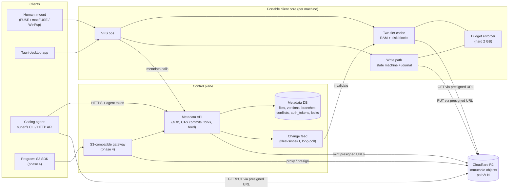
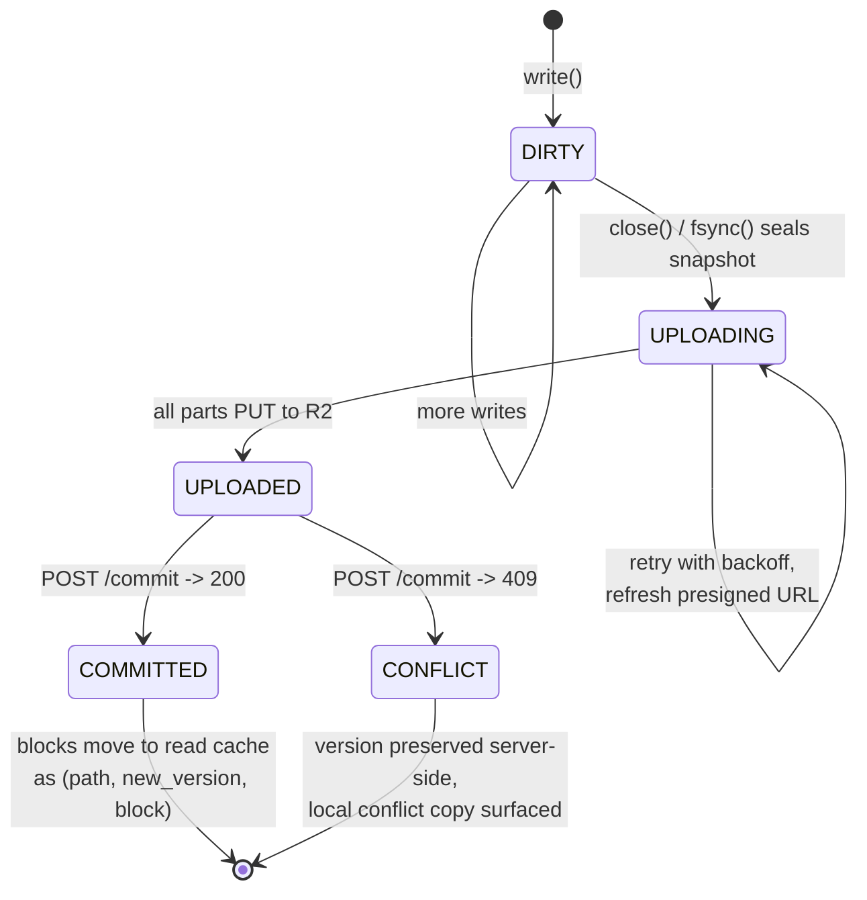

# Superfs — Architecture

Status: draft · Related: [PRD](prd.md), [mount design](mount-design.md)

This document describes how Superfs stores bytes, tracks versions, forks drives, resolves conflicts, and runs a bounded-footprint client on every platform.

## 1. System topology



Principles:

- **R2 holds bytes, never truth.** The metadata DB decides which version is current. R2 objects are write-once.
- **Bytes skip the API.** Clients move data directly to and from R2 with short-lived presigned URLs. The API handles only small JSON requests.
- **One sequence number per drive.** Every commit gets a monotonic `seq`. Forks, the change feed, and conflict detection all use `seq`. Wall-clock time is never used for ordering.

## 2. Object storage (R2)

### 2.1 Key layout

```text
{drive_id}/{path}/v-{N}
```

- `N` is a per-`(drive, path)` counter allocated by the metadata service when an upload is requested. It is unique across **all branches**, so a fork and its parent never collide on a key.
- Objects are **immutable**. Nothing ever overwrites an existing key. This avoids R2's last-writer-wins behavior for same-key writes.
- The exact key is stored in `versions.r2_key`, not recomputed from the path. A rename creates a new version row on the new path that points at the **same** object, with no copy.
- Large files use R2 multipart upload (the API presigns each part). The resulting object is still a single `v-N` key.

### 2.2 Lifecycle

| State | Meaning | Cleanup |
|---|---|---|
| Reserved | `upload-url` issued, `N` allocated, object may be partially uploaded | Aborted after 24 h if not committed (multipart abort + delete) |
| Committed | Referenced by a `versions` row | Kept while referenced by any version on any branch within retention |
| Orphaned | No version references it (e.g. a deleted fork's private writes) | Mark-and-sweep GC, after a grace period |

## 3. Metadata API

All endpoints are under `/v1/drives/{drive_id}`. Every request carries a user session or a machine token (§9). `branch` defaults to the drive's main branch. Responses include the server's current `seq`.

| Method & path | Purpose | Key request fields | Key response fields |
|---|---|---|---|
| `POST /upload-url` | Reserve a new version and get presigned PUT URL(s) | `path`, `branch`, `size`, `sha256`, `parts?` | `upload_id`, `version_no` (N), `urls[]`, `expires_at` |
| `POST /commit` | Compare-and-swap publish of an uploaded object | `upload_id`, `path`, `branch`, `base_version` (or `null` for create) | `200 {version, seq}` or `409 {conflict_id, head_version}` |
| `GET /download-url` | Presigned GET for a version | `path`, `version?` or `branch?` (resolves head, with fork fall-through) | `url`, `version`, `size`, `sha256`, `expires_at` |
| `GET /history` | Version list for a path | `path`, `branch?`, `limit`, `cursor` | `versions[]` (N, author, base_version, branch, seq, size, created_at, op) |
| `POST /restore` | New version whose content equals an old one (no byte copy) | `path`, `version`, `base_version`, `branch` | `version`, `seq` (CAS like `commit`) |
| `GET /files?since=T` | Change feed / incremental listing | `since` (seq cursor), `branch`, `prefix?`, `wait?` (long-poll seconds) | `changes[]` (path, op, version, author, branch, seq), `next` cursor |
| `GET /files` | Directory listing at head | `prefix`, `branch` | entries with head version + attrs |
| `POST /tokens` | Mint a scoped machine token | `label`, `scopes[]` (prefix, perms), `branch?`, `expires_at` | `token` (shown once), `token_id` |
| `DELETE /tokens/{id}` | Revoke a token and all tokens derived from it | — | `204` |
| `POST /forks` | Constant-time fork of a branch | `from_branch`, `at_seq?` (default: now), `label` | `branch_id`, `fork_point_seq` |
| `GET /forks/{id}/diff` | Paths changed on the fork vs parent since fork point | — | `changes[]` |
| `POST /forks/{id}/merge` | Merge fork into parent (CAS per path) | `strategy` (`fail_on_conflict` \| `record_conflicts`) | merged paths, `conflicts[]` |
| `DELETE /forks/{id}` | Abandon fork | — | `204` |
| `GET /conflicts` / `POST /conflicts/{id}/resolve` | List and resolve conflicts | `resolution` (`ours` \| `theirs` \| `version`) | resolved head `version` |
| `POST /locks` (reserved, phase 4) | Advisory lock | `path`, `ttl` | `lock_id` |

Idempotency: `commit` is idempotent on `upload_id`. If a client retries after a lost response, it gets the original result back.

## 4. Database schema

PostgreSQL (or any SQL store with serializable transactions). `drives` and `users` tables are assumed and omitted.

```sql
CREATE TABLE branches (
    id              UUID PRIMARY KEY,
    drive_id        UUID NOT NULL,
    parent_branch   UUID REFERENCES branches(id),      -- NULL for main
    fork_point_seq  BIGINT,                            -- parent's seq at fork time; NULL for main
    label           TEXT,
    created_by      TEXT NOT NULL,                     -- author id (user or token)
    state           TEXT NOT NULL DEFAULT 'open',      -- open | merged | abandoned
    created_at      TIMESTAMPTZ NOT NULL DEFAULT now()
);

CREATE TABLE files (                                   -- head pointer per (branch, path)
    branch_id       UUID NOT NULL REFERENCES branches(id),
    path            TEXT NOT NULL,
    head_version    UUID NOT NULL,                     -- -> versions.id
    is_deleted      BOOLEAN NOT NULL DEFAULT false,    -- tombstone hides parent's copy on forks
    updated_seq     BIGINT NOT NULL,
    PRIMARY KEY (branch_id, path)
);

CREATE TABLE versions (
    id              UUID PRIMARY KEY,
    drive_id        UUID NOT NULL,
    branch_id       UUID NOT NULL REFERENCES branches(id),
    path            TEXT NOT NULL,
    version_no      BIGINT NOT NULL,                   -- N in path/v-N
    seq             BIGINT NOT NULL,                   -- drive-wide monotonic commit sequence
    base_version    UUID REFERENCES versions(id),      -- what the author edited from
    author_kind     TEXT NOT NULL,                     -- user | token
    author_id       TEXT NOT NULL,                     -- set server-side from auth, never by client
    op              TEXT NOT NULL,                     -- put | delete | restore | rename | merge
    r2_key          TEXT,                              -- NULL for delete
    size            BIGINT,
    sha256          BYTEA,
    created_at      TIMESTAMPTZ NOT NULL DEFAULT now(),
    UNIQUE (drive_id, path, version_no)
);
CREATE INDEX versions_branch_path_seq ON versions (branch_id, path, seq DESC);
CREATE INDEX versions_drive_seq       ON versions (drive_id, seq);   -- change feed

CREATE TABLE conflicts (
    id              UUID PRIMARY KEY,
    branch_id       UUID NOT NULL REFERENCES branches(id),
    path            TEXT NOT NULL,
    base_version    UUID REFERENCES versions(id),      -- common ancestor
    head_version    UUID NOT NULL REFERENCES versions(id),  -- won the CAS
    losing_version  UUID NOT NULL REFERENCES versions(id),  -- preserved, not head
    status          TEXT NOT NULL DEFAULT 'open',      -- open | resolved
    resolved_by     TEXT,
    resolution      UUID REFERENCES versions(id),
    created_at      TIMESTAMPTZ NOT NULL DEFAULT now()
);

CREATE TABLE auth_tokens (
    id              UUID PRIMARY KEY,
    drive_id        UUID NOT NULL,
    token_hash      BYTEA NOT NULL UNIQUE,             -- SHA-256 of secret; secret never stored
    label           TEXT NOT NULL,                     -- shown as author, e.g. "agent:refactor-bot"
    created_by      TEXT NOT NULL,                     -- user or parent token
    parent_token    UUID REFERENCES auth_tokens(id),   -- derived tokens are revoked with parent
    scopes          JSONB NOT NULL,                    -- [{prefix:"/docs/", perms:["read","write"]}]
    branch_id       UUID REFERENCES branches(id),      -- optional: restrict to one fork
    expires_at      TIMESTAMPTZ NOT NULL,
    revoked_at      TIMESTAMPTZ,
    last_used_at    TIMESTAMPTZ
);

CREATE TABLE locks (                                   -- reserved; API ships in phase 4
    branch_id       UUID NOT NULL REFERENCES branches(id),
    path            TEXT NOT NULL,
    holder          TEXT NOT NULL,
    expires_at      TIMESTAMPTZ NOT NULL,
    PRIMARY KEY (branch_id, path)
);
```

## 5. Forks (branches)

### 5.1 Creating a fork is metadata-only and constant time

`POST /forks` inserts **one** `branches` row: `(parent_branch = from_branch, fork_point_seq = current seq)`. It copies no `files` rows and no R2 objects. Cost is O(1) regardless of drive size.

### 5.2 Copy-on-write resolution

To resolve `path` on branch `B`:

```text
resolve(B, path, limit_seq = +inf):
    row = files[B, path]                       # fork's own writes
    if row exists and row.updated_seq <= limit_seq:
        return row.is_deleted ? NOT_FOUND : row.head_version
    if limit_seq < +inf:                       # B is an ancestor seen through a fork
        v = latest versions where branch=B, path=path, seq <= limit_seq
        if v: return v.op == delete ? NOT_FOUND : v
    if B.parent_branch is NULL: return NOT_FOUND
    return resolve(B.parent_branch, path, min(limit_seq, B.fork_point_seq))
```

- **Reads fall through** to the parent branch **as of the fork point**. Later commits on the parent are invisible to the fork until it is rebased or merged.
- **Writes land on the fork's branch.** The first write to a path creates a `files` row for the fork. Its `base_version` is the version found by fall-through.
- **Deletes on a fork** write a tombstone (`is_deleted = true`) so the parent's copy stays hidden.
- **Listings** merge the fork's rows with the parent's view at the fork point, recursively, with tombstones applied. Server-side this is one recursive CTE. Fork depth is capped (e.g. 8) to keep it bounded.

### 5.3 Merge

`POST /forks/{id}/merge` walks the fork's `files` rows. For each path it runs the same CAS as `commit` against the parent: if the parent's head is still the fork's `base_version`, the parent fast-forwards to the fork's version (a new `versions` row with `op = merge` that reuses the same `r2_key`). Otherwise a conflict is recorded (§6). Merging copies no bytes.

## 6. Conflict model: compare-and-swap

Every write states the version it was based on. `commit` runs in a single serializable transaction:

```text
BEGIN
  head = SELECT head_version FROM files WHERE branch_id = B AND path = P FOR UPDATE
         (or the fall-through result if no row)
  IF head == base_version:
      insert versions row (seq = nextval), upsert files.head_version
      COMMIT -> 200
  ELSE:
      insert versions row (kept, not head), insert conflicts row
      COMMIT -> 409 {conflict_id, head_version}
```

Rules:

- **Nothing is ever lost.** The losing write is still a committed version, with its author, reachable from `history` and `conflicts`.
- **First committer wins head**, whether human or agent. The other side gets a 409.
- **Human vs agent:** a human's edit is never auto-discarded in favor of an agent's. If an agent loses, it gets a 409 and should rebase or report back. If a human loses to an agent, the mount materializes the losing version as a visible conflict copy (`file.conflict-v<N>.ext`) and the Tauri app shows a resolution prompt. The recommended workflow is that agents work on forks, so conflicts only appear at merge time, where a human reviews them.
- **Safe auto-merge** (e.g. non-overlapping text hunks, disjoint JSON keys) is a later, opt-in resolution strategy. It never runs implicitly in v1.

## 7. Client cache

### 7.1 Two tiers

| Tier | Contents | Key | Eviction |
|---|---|---|---|
| RAM | Hot blocks + open-file buffers | `(path, version, block_index)` | LRU, demote to disk |
| Disk block cache | Committed file blocks | `(path, version, block_index)` | LRU |
| Metadata cache (disk + RAM) | Attrs, dir listings, head versions, negative lookups | `(branch, path)` | LRU + invalidated by change feed |

- Block size is **256 KB–1 MiB** (default 1 MiB). Small files are a single (short) block.
- Reads go RAM → disk → HTTP Range fetch from R2, and fetched blocks are stored in both tiers. A sequential prefetcher reads ahead 1–10 blocks, adapting to measured throughput.
- Keys include `version`, so a cached block is **never stale**: a new version has a new key. Invalidation only touches the metadata cache (which version is head). Old blocks age out through LRU.
- Blocks are written to disk with a checksum. A corrupt block is dropped and re-fetched.

### 7.2 Fixed 2 GB budget (no user tuning)

| Budget | Size | Notes |
|---|---|---|
| Read cache (RAM tier + disk tier, exclusive) | ~1.7 GB | RAM tier ≤ 128 MB of this |
| Pending-write buffer | ~250 MB | Dirty and uploading data. **Never evicted.** When full, writes block (backpressure) until uploads drain. |
| Metadata cache | ~50 MB | SQLite + in-memory index |
| **Hard cap** | **2 GB** | Enforced by a single budget accountant. Space is reserved before allocation. |

- The disk cache is **on by default**. No user-visible setting changes these numbers. The only exception is a hidden config flag for pure-streaming mode (no disk cache).
- If the volume has less free space than the budget, the client shrinks the read cache to fit. It never grows past 2 GB.
- The pending-write buffer can borrow from the read cache by evicting clean blocks. It can never take space from the metadata budget.
- A single file larger than the pending-write buffer fails with a clear error in the MVP. Streaming upload comes later.

## 8. Write path

### 8.1 State machine (per file write generation)



- **Sealing:** on `close()`/`fsync()`, the current dirty generation becomes an immutable snapshot. New writes to the same file start a **new DIRTY generation** on top of it. Uploads never block writers, except through budget backpressure.
- **Journal:** every state transition is recorded in an on-disk journal (fsync'd) before it takes effect. After a crash, the client resumes: DIRTY data is kept, UPLOADING restarts the upload with the same `upload_id`, UPLOADED retries the idempotent commit.
- **Commit ordering:** generations of one file commit in order. Generation *k+1* uses generation *k*'s committed version as its `base_version`.

### 8.2 Read-during-upload

While a file has data in DIRTY or UPLOADING, reads go through an overlay, block by block:

1. Newest DIRTY generation's block, if written.
2. Else a sealed (UPLOADING/UPLOADED) snapshot's block, if written.
3. Else the **committed base version's block**, from RAM, then disk cache, then R2.

So readers always see their own writes immediately. Unmodified blocks of a large file are served from committed data and never wait on the upload.

## 9. Auth

| Principal | How obtained | Form | Typical use |
|---|---|---|---|
| **User session** | OIDC sign-in (Tauri app / `superfs login`) | Short-lived access JWT (15 min) + rotating refresh token | Humans on mount, CLI, app |
| **Machine token** | `POST /tokens` by a user (or by a token with the `mint` permission, which can only mint narrower tokens) | Opaque `sfs_…` secret. Only its SHA-256 is stored. | Agents, CI, sandboxes, folder sharing |

- **Scopes** are lists of `(path prefix, perms)` with perms from `read`, `write`, `fork`, `watch`, `mint`. Tokens can also be restricted to one branch (e.g. an agent can only write to its own fork) and must have an expiry.
- **Enforcement is server-side, on every request.** That covers path resolution, listings (out-of-scope names are not returned), the change feed (filtered by scope), and presigning (a URL is only minted for an authorized object).
- **Presigned URLs** last 5 minutes and cover one object (or one multipart part).
- **Revocation** sets `revoked_at` and cascades to derived tokens. The API's token cache TTL is ≤ 5 s. Already-issued presigned URLs can still be used until they expire, which is at most 5 minutes.
- **Attribution:** `versions.author_*` is filled in from the authenticated principal, never from the request body.

## 10. Platform abstraction

```text
┌───────────────────────────────────────────────────────────┐
│ Portable core (Rust, proposed)                            │
│  vfs ops · cache · write path · journal · budget ·        │
│  metadata client · R2 transfer · change-feed watcher      │
└───────────────┬───────────────┬───────────────┬───────────┘
                │ Vfs trait     │               │
        ┌───────▼─────┐ ┌───────▼──────┐ ┌──────▼───────┐ ┌──────────┐
        │ FUSE shim   │ │ macFUSE shim │ │ WinFsp shim  │ │ CLI/API  │
        │ (Linux)     │ │ (macOS)      │ │ (Windows)    │ │ (no mount)│
        └─────────────┘ └──────────────┘ └──────────────┘ └──────────┘
```

- The shims only translate OS callbacks into the core's `Vfs` trait and map errors to errno or NTSTATUS. They hold no caching or sync logic.
- Platform quirks (case-insensitivity on macOS/Windows, Windows share modes, `.DS_Store`/`Thumbs.db` noise) are handled in the core behind capability flags so behavior stays consistent.
- The Tauri app embeds the same core and drives the mount through it.
- The interface contract is in [mount-design.md](mount-design.md).

## 11. Failure modes

| Failure | Detection | Behavior | User impact |
|---|---|---|---|
| Network offline / partition | Request timeouts, feed disconnect | Reads of cached data still work. Uncached reads return `EIO` after a timeout. Writes queue in the pending buffer. | Work continues on cached files. Sync status shows offline. |
| Metadata API down | 5xx / timeouts | Same as offline. Commits retry with backoff. | Delayed sync. |
| R2 unavailable or slow | PUT/GET errors | Retry with backoff and fresh presigned URLs. Uploads stay in UPLOADING. | Delayed sync. Uncached reads fail. |
| Client crash mid-write | Journal replay on start | DIRTY data recovered. Data not yet close()d/fsync()d may be lost (see mount design). | At most the unsealed edits since the last close/fsync. |
| Crash after upload, before commit | Journal shows UPLOADED | Commit retried. Idempotent on `upload_id`. | None. |
| Lost commit response | Retry returns original result | Idempotent. | None. |
| Presigned URL expired mid-upload | 403 from R2 | Request new URL for the same `upload_id`. | None. |
| Pending-write buffer full | Budget accountant | Writers block (backpressure). Clean read blocks are evicted first. | Writes slow down. Nothing is dropped. |
| File larger than pending-write buffer | Size check before sealing | Clear error to the writer (MVP). Streaming upload later. | Visible error. Nothing is lost. |
| Disk full on host | `ENOSPC` from local FS | Shrink read cache. If still full, return `ENOSPC` to the writer. | Visible error. Committed data is safe. |
| Stale-version write (concurrent edit) | CAS 409 | Conflict recorded. Both versions kept. | Conflict copy and prompt. |
| Token revoked or expired mid-session | 401 / 403 | Stop syncing. Keep pending writes locally. Prompt to re-auth. | Writes stay local until re-auth. |
| Remote change to a cached file | Change feed | Metadata invalidated. Next open sees the new head. | Eventual (< 2 s p95). |
| Feed gap (client offline for a long time) | Cursor older than retention | Full metadata resync for the subtree. | One-time slow rescan. |
| Orphaned R2 objects | GC mark-and-sweep | Deleted after a grace period. | None. |
| Corrupt local cache block | Checksum mismatch | Drop and re-fetch. | Small latency hit. |
| DB failover | Connection errors | Serializable txns retried. `seq` stays monotonic (DB sequence). | Brief write unavailability. |
