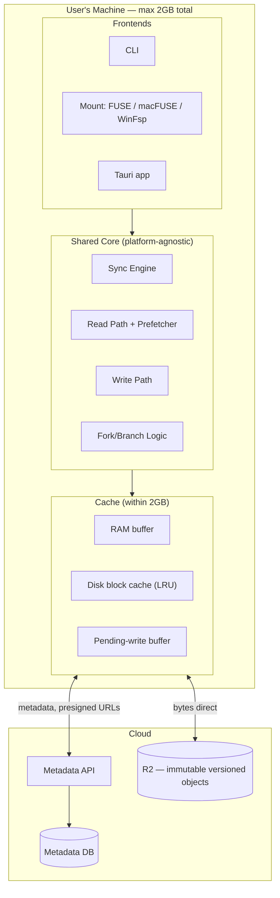

# Superfs — Product Requirements Document

Related: [architecture](architecture.md), [mount design](mount-design.md)

## 1. Vision

**Infinite storage for everyone — one filesystem shared by people, programs, and coding agents.**

Superfs presents cloud-stored files as if they were local, without requiring a complete copy on any device. Humans mount it as a folder; agents reach it over CLI/API; programs (later) reach it over S3. The entire client footprint — cache, buffers, metadata, binary — never exceeds 2GB.

**Competitive frame:** Space ([spacefs.com](https://spacefs.com)) sells "the infinite AI-native filesystem" with mount + S3 + forks. Superfs's wedge is the agent workflow done deeply — forks, per-version attribution, conflict UX, sandbox integration — plus radical simplicity (2GB guarantee, zero-config).

## 2. Goals

- Files appear instantly; contents stream on demand
- Changes sync across devices and agent sandboxes
- Full version history; any version restorable
- Overlapping edits never silently destroy data — conflicts are preserved
- Agents are first-class users: scoped tokens, attributed writes, constant-time forks
- Zero-configuration UX: install, `superfs init`, done
- Linux, macOS, Windows

## 3. Non-goals (MVP)

- Real-time collaboration / live cursors
- Automatic merging of conflicting edits (detection + preservation only)
- Multi-user permissions/teams (single user, many devices + agents)
- Offline write queueing beyond the pending-write buffer
- Mobile clients
- S3-compatible endpoint (phase 4)

## 4. User stories

| # | Story | Priority |
|---|---|---|
| 1 | Run `superfs init`, connect account in one step | P0 |
| 2 | push/pull files, view history via CLI | P0 |
| 3 | Stale edit → both versions preserved, user notified | P0 |
| 4 | Disk usage never exceeds 2GB | P0 |
| 5 | Agent sandbox authenticates with scoped, revocable token; reads/writes same files | P0 |
| 6 | Every version shows its author — human or specific agent session | P0 |
| 7 | Open `~/Superfs/` as a real folder; any app reads/writes it | P1 |
| 8 | Agent forks the drive in constant time, works, human reviews or discards the fork | P1 |
| 9 | Agent polls change feed to learn when files changed | P1 |
| 10 | Share exactly the folders a partner needs via token scopes | P1 |
| 11 | Manage Superfs via lightweight Tauri desktop app | P2 |
| 12 | Any S3 client works unchanged against an S3-compatible endpoint | P3 |

## 5. Product surfaces

| Surface | Users | Phase |
|---|---|---|
| CLI (`init`/`pull`/`push`/`status`/`log`/`restore`/`fork`/`config`) | Everyone; agents natively | 1 |
| Mount (FUSE / macFUSE / WinFsp) | Humans, any app | 2 |
| Forks + change feed | Agents | 2–3 |
| Tauri desktop app | Humans | 3 |
| S3-compatible endpoint | Programs/SDKs | 4 |

## 6. Functional requirements

### 6.1 Storage & versioning

- File contents in Cloudflare R2 as immutable objects: `<project>/<path>/v-<version>`
- Every write = new version key; nothing overwritten
- Any version restorable (restore copies version N forward as new current)

### 6.2 Conflict model (compare-and-swap)

- Every write declares `base_version`; commit succeeds iff `base_version == current_version`
- Stale base → uploaded version still committed to history, current stays on winner, conflict record created, loser materializes `file.conflict-v<N>.ext`
- Conflicts are a core feature, not an edge case — human-vs-agent collisions are expected

### 6.3 Forks (copy-on-write branches)

- `fork` = metadata-only, constant-time operation — zero bytes copied
- Reads: latest version on my branch, else fall through to parent's fork point
- Writes: always land on my branch
- Enables "a fork per agent task; experiments never touch live files"

### 6.4 Cache (the 2GB budget)

- Two tiers: RAM buffer → disk block cache → R2
- Block-keyed `(path, version, block_index)`, 256KB–1MB blocks — version-keying makes invalidation free
- Internal split (invisible to user): ~1.7GB read cache / ~250MB pending writes / ~50MB metadata+binary
- LRU eviction — always safe, everything re-fetchable
- Setup: disk cache on by default, no size option shown; pure-streaming mode is a hidden config flag only

### 6.5 Read path

- `read(path, offset, len)` → RAM → disk → Range-fetch from R2 → store both tiers
- Sequential prefetcher with adaptive lookahead (1–10 blocks based on measured throughput)
- Read-during-upload: committed blocks of an in-progress upload are fetchable

### 6.6 Write path

- State machine: `DIRTY → UPLOADING → UPLOADED → COMMITTED` (or `CONFLICT`)
- Writes buffered durably in pending-write area; upload on `close()`/`fsync`/`push`
- Crash before `COMMITTED` → buffer replays on restart; nothing acknowledged is lost
- File larger than write buffer → clear error (MVP); streaming upload later

### 6.7 Auth

- Two identity types: user sessions (interactive login) + machine tokens (scoped, expiring, revocable)
- Token scopes: e.g. `read:*`, `write:project/docs/*` — enables folder-scoped sharing
- Same permission checks on both; author recorded on every version

### 6.8 Mount semantics (phase 2)

- ~40 POSIX callbacks against the core's internal API
- `rename` emulated (copy + metadata update + delete), must be crash-safe
- Metadata (`stat`/`readdir`) served from pinned RAM cache — OS generates heavy metadata traffic; mark mount to skip indexers (Spotlight etc.)
- Platform code is syscall translation only; all policy in portable core

## 7. System architecture

Full detail: [architecture.md](architecture.md).



### Metadata API endpoints

| Endpoint | Purpose |
|---|---|
| `POST /files/:path/upload-url` | Validate base version → presigned R2 PUT for `path/v-N+1` |
| `POST /files/:path/commit` | Atomic version bump; stale base → conflict record |
| `GET /files/:path/download-url?v=N` | Presigned R2 GET |
| `GET /files/:path/history` | Versions w/ author, timestamp, size |
| `POST /files/:path/restore` | Copy version N forward as current |
| `GET /files?since=T` | Change feed (polling now, websockets later) |
| `POST /tokens` | Mint scoped, expiring, revocable machine tokens |
| `POST /forks` | Create branch — metadata-only, constant time |

### Schema

```text
files(path, branch_id, current_version, updated_at, updated_by, PK(path, branch_id))
versions(path, branch_id, version, r2_key, size, hash, author, base_version, created_at)
conflicts(path, version_a, version_b, detected_at, resolved)
branches(id PK, name, parent_branch, fork_point, created_at)
auth_tokens(token PK, name, scope, created_by, created_at, expires_at, revoked_at)
locks(path PK, holder, acquired_at, expires_at)  -- reserved, post-MVP
```

## 8. Failure modes & honest limits

| Failure | Behavior |
|---|---|
| Slow network | Prefetch shrinks; seeks stall; degrades to connection speed |
| File > write buffer | Clear error (MVP) |
| Crash mid-write | Pending-write buffer replays; no acknowledged data lost |
| Offline | Cached blocks readable; rest errors cleanly |
| Whole-tree scans (`grep -r`) | Defeats prefetch; slow — documented limitation |
| Mount + network stall | Apps freeze in `read()` — raises bar on timeouts/prefetch |

## 9. Success metrics

- Cold-open cache miss < 1.5× raw download time to first block
- Cached open indistinguishable from local disk
- 100% of conflicting versions preserved
- Footprint ≤ 2GB verified under stress test
- Mount passes pjdfstest POSIX conformance on all three OSes

## 10. Build order

1. **CLI MVP** — API + R2 + sync engine + cache + CLI (proves the pipeline; agents can use it immediately)
2. **Mount design doc** — internal interface + write-path semantics frozen before FUSE code (enables parallel agent implementation)
3. **Mount** — per-OS bindings against frozen interface
4. **Forks + change feed**
5. **Tauri frontend**
6. **Later** — S3 endpoint, notifications, locks, safe merges, multi-user permissions

## 11. Testing strategy

- Devin hosted machines: Ubuntu (primary dev), macOS, Windows — real per-OS mount testing in-session
- GitHub Actions matrix (`ubuntu`/`windows`/`macos-latest`) for every-push regression; WinFsp/macFUSE installable in CI
- pjdfstest for POSIX conformance; crash-recovery and slow-network test suites
- Thin-platform-shim rule keeps ~90% of code testable on Linux

## 12. Key risks

- **Write-path correctness** — the single most bug-prone area (dirty blocks, crash safety, POSIX semantics over immutable objects)
- **Conflict UX** — detection is easy; good resolution UX is not, and agent collisions make it frequent
- **OS-generated mount traffic** — indexers/thumbnails/AV can make the mount feel broken without aggressive metadata caching
- **Space's head start** — mitigation is focus: agent workflow depth + 2GB simplicity guarantee, not feature parity
